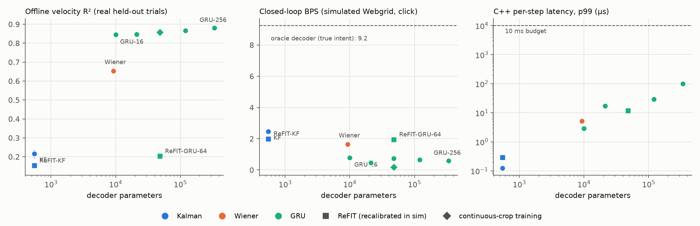
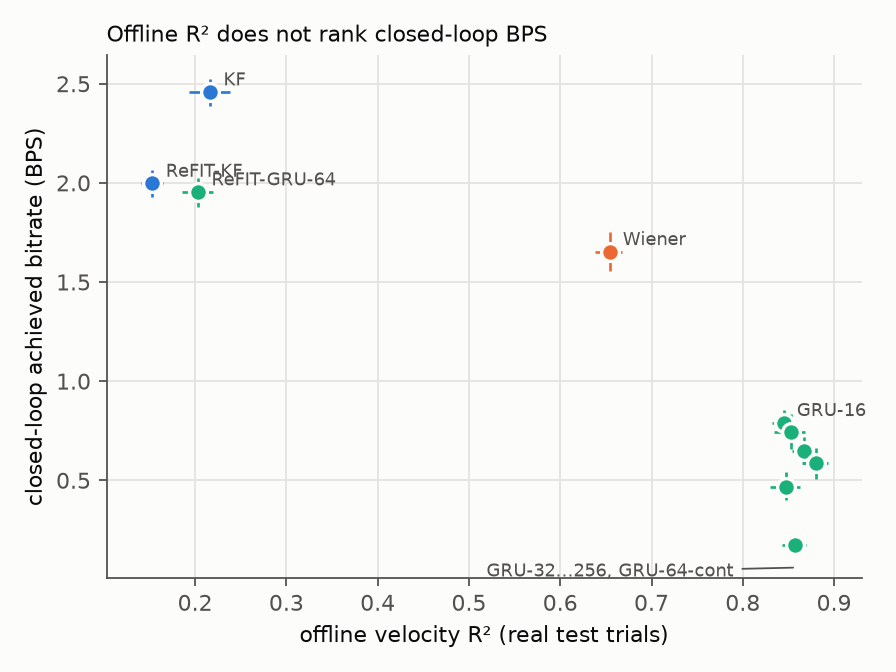
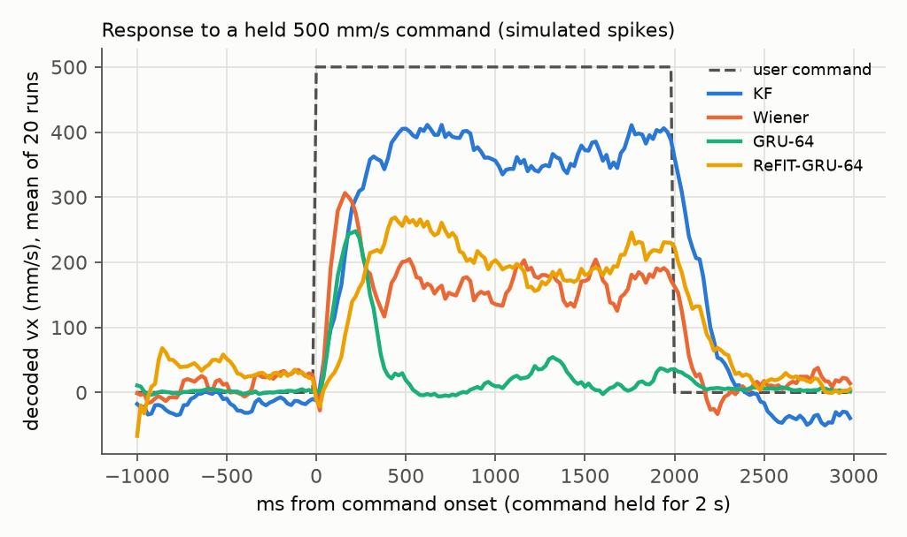
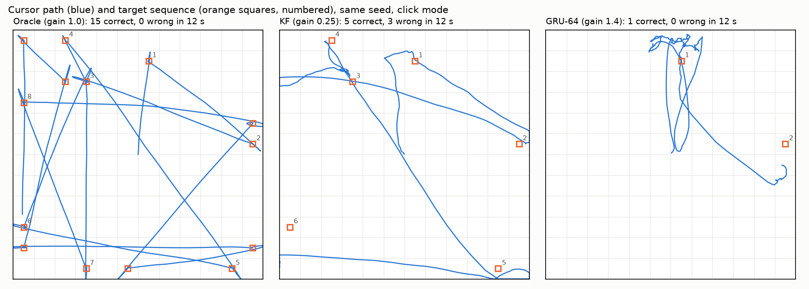
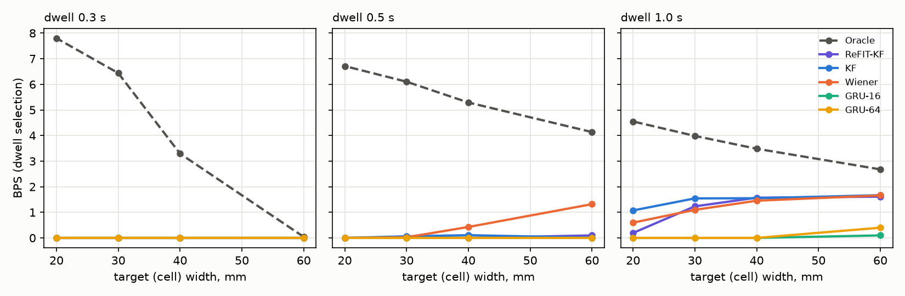
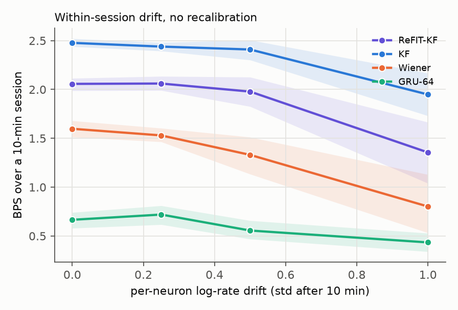

# closed-loop-bps

**Does offline decoding accuracy predict closed-loop cursor control?** This repo trains intracortical
velocity decoders on real monkey motor-cortex data, then drops them into a simulated Webgrid task where
a simulated user steers by watching the decoded cursor, and scores them in **bits per second**: the
achieved-bitrate metric BrainGate and Neuralink report. It also runs the decoders in a C++ inference
loop on 20 ms bins and measures per-step latency.

Short answer from this repo: **no, at least not here.** Offline R² ranks the decoders
GRU ≫ Wiener ≫ Kalman. Simulated closed-loop BPS ranks them the other way. The repo traces the
reversal to a specific, measurable distribution shift, shows which results depend on the simulated
user's correction model, and measures how far the simulator is from the real neurons.

Every number below comes from a file in [`results/`](results/): the table and figures are generated from them, and numbers in the prose are quoted from them.

## Results

MC_Maze, 182 units, 20 ms bins. 1,567 / 335 / 336 train / val / test trials (chronological).
BPS: simulated Webgrid, 40 two-minute sessions per decoder, the same seeds for every decoder, mean
with 95% bootstrap CI. Click: 12×12 grid (N = 144, 7.16 bits per net correct selection). Dwell: 6×6
grid, 40 mm targets, 1 s dwell (N = 36). Latency: C++ `step()` on one 20 ms bin, 100k steps, Apple
M5 Pro, single thread.

| Decoder | Params | Offline R² (test, 95% CI) | Sim BPS, click (95% CI) | gain | Sim BPS, dwell (6×6, 1 s) | C++ p50 / p99 (µs) |
|---|---:|---|---|---:|---|---|
| KF | 550 | 0.216 [0.193, 0.238] | 2.46 [2.39, 2.53] | 0.25 | 1.77 [1.74, 1.81] | 0.1 / 0.1 |
| ReFIT-KF | 550 | 0.153 [0.141, 0.165] | 2.00 [1.93, 2.07] | 0.5 | 1.52 [1.48, 1.56] | 0.1 / 0.3 |
| Wiener | 9,284 | 0.654 [0.638, 0.668] | 1.65 [1.56, 1.75] | 0.5 | 1.56 [1.51, 1.62] | 4.5 / 5.1 |
| GRU-16 | 9,998 | 0.845 [0.832, 0.856] | 0.79 [0.72, 0.86] | 0.5 | 0.02 [0.00, 0.04] | 2.2 / 2.9 |
| GRU-32 | 21,166 | 0.847 [0.830, 0.862] | 0.47 [0.40, 0.54] | 2.0 | 0.00 [0.00, 0.01] | 4.8 / 17.3 |
| GRU-64 | 48,110 | 0.853 [0.834, 0.869] | 0.75 [0.66, 0.84] | 1.4 | 0.07 [0.03, 0.10] | 10.4 / 11.8 |
| GRU-128 | 120,430 | 0.867 [0.854, 0.879] | 0.65 [0.58, 0.72] | 2.0 | 0.08 [0.04, 0.13] | 27.1 / 29.0 |
| GRU-256 | 338,798 | 0.881 [0.865, 0.893] | 0.59 [0.51, 0.67] | 1.0 | 0.00 [0.00, 0.01] | 91.8 / 99.1 |
| GRU-64-cont | 48,110 | 0.857 [0.843, 0.869] | 0.17 [0.13, 0.23] | 2.8 | 0.00 [0.00, 0.00] | 10.4 / 12.1 |
| ReFIT-GRU-64 | 48,110 | 0.203 [0.186, 0.220] | 1.95 [1.88, 2.03] | 0.5 | 1.23 [1.18, 1.28] | 10.4 / 11.7 |
| Oracle (decoded = true intent) | 0 | n/a | 9.24 [9.20, 9.28] | 1.0 | 3.58 | n/a |

*`gain`* is the click-mode output gain, tuned on calibration seeds over 0.18–4.0. Sources:
`results/offline.json`, `closed_loop.json`, `latency.json`, `diagnostics.json`. The table is
generated into `results/summary.md` by `scripts/06_figures.py`.



### What the numbers say

1. **Offline R² does not predict closed-loop BPS.** On real held-out trials the GRUs reach
   R² 0.845–0.881, the Wiener filter 0.654, and the velocity KF 0.216. In simulated closed loop the KF
   is best (2.46 BPS), the Wiener filter next (1.65), and the trial-trained GRUs last (0.47–0.79).
   Every trial-trained GRU's paired difference vs KF is between −1.6 and −2.0 BPS, with CIs excluding 0. The largest
   GRU has the best R² and among the worst BPS.
   

2. **Why the GRUs lose: distribution shift from open-loop training, not gain or feedback.**
   - *No feedback involved:* spikes are generated open loop from command streams, with no user
     reacting to the cursor (`diagnostics.json → open_loop_distribution_shift`). On MC_Maze-style
     reaches, GRU-16 delivers 60% of the commanded speed. On Webgrid command streams (continuous
     target-to-target movement, 35% of bins near rest vs 64% in MC_Maze trials), it delivers 24%. KF
     and Wiener deliver about 53–55% on both.
   - *Held-command probe:* with a 500 mm/s command held for 2 s, the KF sustains 366 mm/s, while
     GRU-64 bursts for ~200 ms and decays to 21 mm/s (`probe_sustained.json`). The GRUs learned that
     reaches are brief, bell-shaped events.
   - *Not gain:* BPS stays low across the whole 0.18–4× gain grid (`closed_loop.json →
     cal_bps_by_gain`). The decay is time-varying, so no fixed gain undoes it.
   - *Not trial timing:* a GRU-64 trained on random 4 s crops of the continuous session with channel
     gain/offset augmentation (`GRU-64-cont`) is as good offline (0.857) and worse in closed loop
     (0.17). No decoder loses more than 0.014 R² when the real 17-minute test block is decoded
     continuously instead of per trial (`continuous_check.json`).
   - *Closed-loop recalibration fixes most of it:* ReFIT-GRU-64 is trained on the KF's closed-loop
     sessions with intention-rotated labels. It sustains output (194 mm/s on the probe) and reaches
     1.95 BPS, matching ReFIT-KF. Its real-data R² falls to 0.203, because it is now fit to the
     simulator's neurons.

   
   

   For the same seed and 12 s, the KF completes 4 targets and GRU-64 completes 1. Its path shows short
   bursts that die out, so the user keeps re-pushing (mean time to target 6.6 s vs 2.5 s for KF).

3. **The simulated user's correction model matters, and an early version was unrealistic.** The
   user predicts the current cursor position from the delayed view plus in-flight commands (an
   efference-copy forward model). Without one, even a perfect decoder oscillates under 160 ms of loop
   delay (oracle BPS 0.00). The first version assumed the cursor moves exactly as hard as the user
   pushes (gain 1), which penalizes any decoder that delivers less speed. The current user learns the
   cursor's gain online (recursive least squares, ~1 s memory). Click BPS under four user models
   (`diagnostics.json → user_ablation_click`):

   | user model | Oracle | KF | ReFIT-KF | Wiener | GRU-16 | GRU-64 |
   |---|---|---|---|---|---|---|
   | adaptive forward model (default) | 9.17 | 2.68 | 2.01 | 1.67 | 0.81 | 0.79 |
   | fixed-gain forward model | 9.19 | 1.16 | 0.43 | 0.37 | 0.24 | 0.31 |
   | no forward model | 0.00 | 2.40 | 1.52 | 2.48 | 1.07 | 0.75 |
   | half-speed user | 8.49 | 2.12 | 2.12 | 1.34 | 0.55 | 0.51 |

   (8 one-minute seeds each, so these differ slightly from the 40-session table.) KF vs Wiener
   ordering **flips** with the user model, so don't read much into it. The trial-trained GRUs are last
   under all four.

4. **ReFIT: it depends.** With the adaptive user, ReFIT recalibration (20 min of closed-loop KF data)
   *lowers* the KF from 2.46 to 2.00 BPS (paired −0.46 [−0.54, −0.38]) and *raises* GRU-64 from 0.75
   to 1.95. An earlier run with the fixed-gain user had ReFIT-KF ahead of KF. This simulator's ReFIT-KF
   result is not robust to the user model and shouldn't be cited as a finding.

5. **Dwell is feasible only with larger targets or longer dwell, and it wasn't a bug.** On the
   original 12×12 grid with 0.5 s dwell, every real decoder scored ≈ 0 while the oracle scored 6.7.
   The error breakdown on that grid (`diagnostics.json → dwell_sweep`) shows the errors aren't
   re-selection of the previous target (KF: 2.6/min). They are 0.5 s dwells on non-target cells
   (KF: 28.6/min vs 19.2 correct/min), because cursor wander with zero intended movement is 22 mm per
   0.5 s (median, KF) on 20 mm targets. With 40 mm targets and 1 s dwell, KF scores 1.77 BPS. The
   GRUs stay near 0 in dwell even there: a cursor that stalls mid-path dwells on wrong cells.
   

6. **Drift.** With per-neuron log-rate drift of 1.0 (std after 10 min) and no recalibration,
   KF falls from 2.48 to 1.95 BPS and Wiener from 1.60 to 0.80 over 10-minute sessions.
   

7. **Latency is not the bottleneck; the OS scheduler is.** Every decoder's C++ step is ≤ 100 µs p99
   (KF 0.1 µs, GRU-256 99 µs), and each reproduces the Python outputs to ≤ 2.3e-6 relative error. In a
   paced 20 ms loop, a spin-waiting thread starts on time and finishes within 117 µs p99. A loop using
   `sleep_until` is woken 5–10 ms late by macOS timer coalescing (p99 9.5–9.9 ms, no missed deadlines):
   most of the 10 ms budget, spent waiting rather than computing.

### Simulator fidelity (measured, `results/encoder_fidelity.json`)

The encoding model reproduces first-order statistics: firing rate 3.24 Hz simulated vs 3.38 Hz real;
20 ms Fano factor 1.04 vs 1.01; 0.134 bits/spike of held-out encoding information. The more telling
check scores every real-trained decoder on spikes generated from the **same real test velocities**:

| | real test R² | simulated-spike R² |
|---|---|---|
| KF | 0.216 | 0.284 |
| Wiener | 0.654 | 0.504 |
| GRU-16 … GRU-256 | 0.845 – 0.881 | 0.497 – 0.553 |

The simulator is **easier than reality for the KF and harder for the GRUs**. Its neurons are what a
linear-Gaussian model assumes, plus noise. The population structure the GRUs exploit in real M1 is
missing. So the closed-loop ranking above is biased toward linear decoders by construction, and the
honest reading is "offline R² can't detect the failure modes in point 2", **not** "Kalman filters beat
RNNs in people." Clinical RNN decoders do work live; they are typically trained on closed-loop data
with heavy augmentation.

## What the simulator can't capture

- **Real population dynamics.** Neurons are velocity-tuned Poisson units (multi-lag GLM) with low-rank
  AR(1) noise. No rotational/preparatory dynamics, position tuning, or condition-specific structure.
  This is the main bias (table above).
- **Learning and adaptation.** The simulated user adapts to one thing, the cursor's gain (online, in
  its forward model). Bias, lag and direction errors are not learned: no re-aiming, no co-adaptation,
  no strategy change across sessions. Results point 3 shows the ranking is sensitive to exactly this.
- **A human motor system.** The reach policy is fit to monkey hand reaches (v_max 1000 mm/s,
  τ 80 ms), with a forward model and fixed 100 ms visual / 200 ms reaction delays. People using a BCI
  are slower, more variable and more cautious.
- **Intended vs attempted movement.** MC_Maze is able-bodied arm reaching. Paralysed users' "attempted"
  movement activity differs, and click decoding is modelled as a fixed miss/false-click process, not
  decoded from neurons.
- **Nonstationarity beyond a random walk.** Drift is independent per-neuron log-rate diffusion. No unit
  loss/gain, no day-to-day change, no correlated array shifts.
- **The real Webgrid.** Grid size, workspace scale and click parameters are plausible choices, not
  Neuralink's or BrainGate's settings. Absolute BPS here is **not comparable** to published human
  numbers; only comparisons between decoders inside this simulator are meaningful, and even those carry
  the bias above.
- **Real-time I/O.** Latency covers decoder compute on prepared bin counts, not spike detection,
  binning, radio, or display.

## Next steps

1. **Close the fidelity gap before trusting the ranking:** replace the GLM with a latent dynamical model
   (e.g. LFADS/SLDS-style) fit to MC_Maze, so simulated spikes keep the structure the GRUs use. Success
   criterion: simulated-spike R² ≈ real R² for every decoder in the fidelity table.
2. **Train RNNs for closed loop:** ReFIT-style labels plus perturbation augmentation, and a
   sustained-command / jitter penalty in the loss, scored by the probe in point 2.
3. **Human-like user:** slower reaches, adaptation to decoder gain/bias across sessions, and a
   learned click decoder.
4. **Real-time thread:** a pinned thread with Mach real-time policy (`THREAD_TIME_CONSTRAINT_POLICY`)
   in place of sleep/spin, plus binning from raw spike events in the C++ loop.
5. **Cross-session evaluation:** apply the sibling FALCON stability work to multi-day decoders in this
   closed-loop harness.


## Pipeline

```
MC_Maze (DANDI 000128, Jenkins, 182 units, 2,295 reaches)
  │  20 ms bins · chronological 70/15/15 split · decode lag 100 ms (chosen on val)
  ├─ offline decoders ─ velocity KF · Wiener (≤40-bin history) · GRU-{16…256}
  │                     R² on held-out test trials, bootstrap CIs over trials
  ├─ encoding model ── Poisson GLM, multi-lag velocity tuning (0–160 ms leads)
  │                     + shared AR(1) latent noise (factor analysis) + private noise + optional drift
  ├─ simulated user ── reach policy fit to real straight reaches, 100 ms visual delay,
  │                     200 ms reaction time, forward model with online-learned cursor gain, motor noise
  ├─ Webgrid ───────── click on 12×12 (primary) or 1 s dwell on 6×6; achieved bitrate
  │                     B = log2(N−1)·max(correct−incorrect, 0)/t
  ├─ ReFIT ─────────── KF closed loop → rotate decoded velocity toward target → refit (KF and GRU)
  ├─ rt/ (C++17) ───── float32 KF / Wiener / GRU step(), checked against Python, latency p50/p99
  └─ diagnostics ───── dwell feasibility, user-model ablation, open-loop shift, trajectories
```

### Design choices that matter for the numbers

- **Chronological split** (first 70% of trials train, next 15% val, last 15% test), not NLB's
  interleaved split. Within-session drift can't leak between train and test.
- **Scoring window [−500, +800] ms around movement onset**, including the still period. A decoder that
  drifts while the user holds still is unusable in closed loop, and the usual [−250, +450] ms window
  hides that. Decoders get 700 ms of burn-in before the window.
- **One causal code path.** `predict()` loops the same `step()` the simulator and the C++ port use, so
  no offline number benefits from looking at future bins. A test checks this.
- **All selection on validation.** Lag, Wiener history/ridge, GRU early stopping and per-decoder gains
  are chosen on validation trials or on calibration seeds disjoint from the evaluation seeds.
- **Common random numbers.** Each evaluation seed fixes the target sequence and all noise streams, and
  every decoder sees the same 40 seeds, so paired differences between decoders are tight.
- **Gain tuning.** Each decoder's output gain (0.18–4×) is tuned on calibration seeds, the way a
  clinician sets cursor speed. Untuned (gain = 1) numbers are in `results/closed_loop.json` too.

## Reproduce

```bash
uv venv --python 3.12 .venv && uv pip install --python .venv/bin/python -r requirements.txt
```

```bash
./run_all.sh
```

`run_all.sh` downloads MC_Maze (691 MB, sha256-checked) and runs scripts `01`–`08` in order. That's
about 40 minutes on an M-series MacBook, CPU only (the Wiener history sweep is the slowest step). Each step writes JSON under `results/`, and
`06_figures.py` regenerates every figure and the results table from those files.

```bash
.venv/bin/python -m pytest -q tests
```

```bash
make -C rt && rt/build/bench rt/models/kf.bin rt/models/kf_ref.bin --steps 100000 --paced-seconds 10
```

The tests use synthetic data, so CI ([`.github/workflows/ci.yml`](.github/workflows/ci.yml)) needs no
download. They cover the bitrate formula, KF steady state vs time-varying, streaming vs batch,
causality, numpy GRU vs torch, GLM recovery, sampler mean rate, drift scale, Webgrid sanity (an oracle
scores and a frozen cursor scores 0), reproducibility, ReFIT labels, and C++ vs Python agreement.

## Layout

| Path | What |
|---|---|
| `cbps/data.py` | NWB → 20 ms bins, trial windows, chronological split, continuous stream |
| `cbps/decoders.py` | KF (steady-state), Wiener, GRU (numpy inference); shared streaming interface |
| `cbps/train_gru.py` | GRU training (trial windows or continuous-stream crops + augmentation) |
| `cbps/encoding.py` | Generative spike model used by the simulator |
| `cbps/webgrid.py` | Task, simulated user, closed-loop session runner, oracle |
| `cbps/refit.py` | ReFIT intention relabelling, ReFIT-KF and ReFIT-GRU |
| `cbps/export.py`, `rt/` | Binary weight format, C++ decoders, latency benchmark |
| `scripts/01…08` | Pipeline steps; each writes `results/*.json` (07: continuous-decoding check, 08: diagnostics) |
